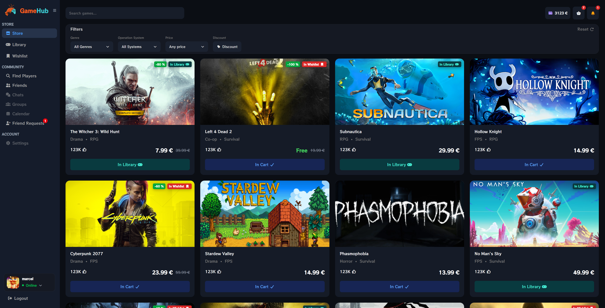
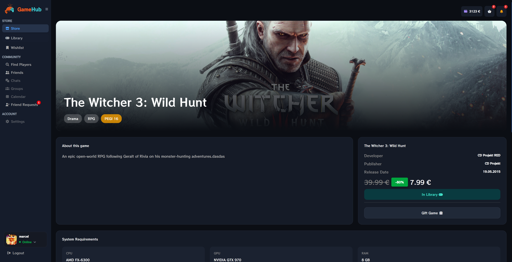
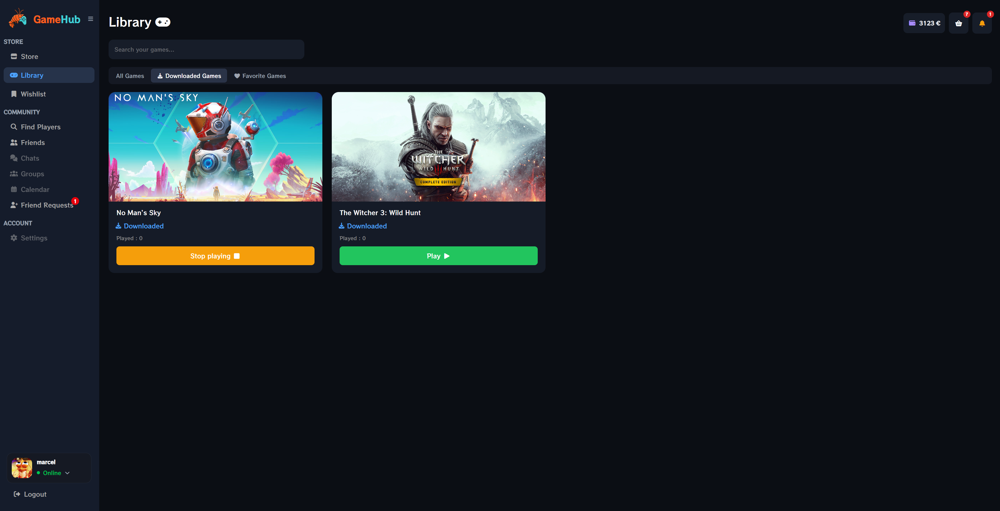
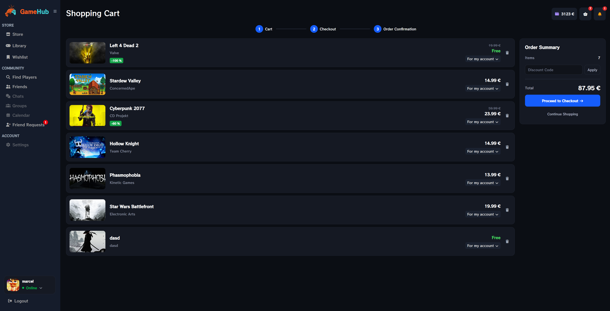
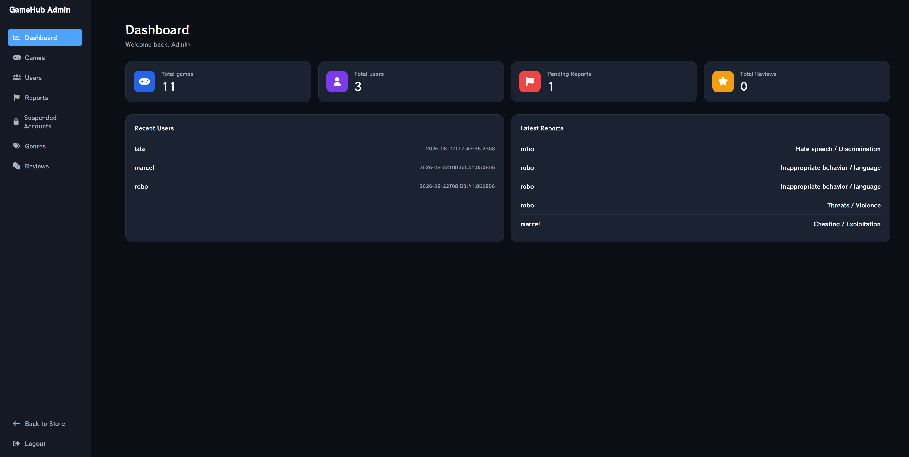
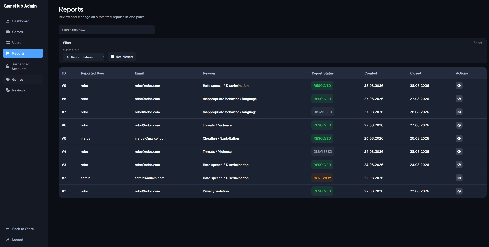

<p align="center">
  
</p>


GameHub is a full-stack web platform for finding people to play with. Instead of just listing games, it focuses on connecting players: you can search for other gamers by country, platform, voice chat preference, and the games they play, or post a “looking for players” ad for a specific game.

Users can send friend requests, browse a catalog of games, build a personal library and wishlist, and customize their profiles with banners, profile pictures, and card colors. The application also includes administration and moderation tools for managing users, reports, and platform content.


### 🚀 Planned Features
* 🔨 “Looking for players” ads (in progress): post an ad with schedule, play style, and preferences such as voice chat or region
* 💬 Chat between users
* 👥 User-created groups
* 🎮 Game Nights: events that group members can join
* 🏆 Group-versus-group events and tournaments
* 🚫 Blocking users
* 🔔 In-app notifications
* 📧 More email notifications, for example when a reported user is banned
* 📱 Improved mobile responsive design

<p align="center">
  
</p>

---

## ✨ Features

### 👤 Community
* Find players with filters: country, platform, voice chat usage, and games
* “Looking for players” ads with game, schedule, play style, and preferences (voice chat, region,..)
* Friend requests: send, accept, reject
* Online status and player profiles

### 👤 User Features

* User registration and authentication
* Password reset
* Detailed game pages
* Profile customization: banners, profile pictures, and card colors
* Browse and search for games, with detailed game pages
* Personal game library and wishlist
* Password reset functionality
* Email notifications on registration, account bans, and suspensions

### 🛠️ Administration & Moderation

* Administrative dashboard
* User management
* Report management
* User moderation tools
* Account bans and suspensions
* Moderation history and account status tracking

---

## 📸 GameHub in Action

### 🎮 Game details in Store

<p align="center">

</p>

### 📚 Game Library

<p align="center">

</p>

### 🛒 Cart

<p align="center">

</p>

---

## 🛠️ Administration

### 📈 Admin Dashboard

<p align="center">

</p>

### 🚨 Reports

<p align="center">

</p>

---

## 🧩 Technical Features

* Persistent data storage using PostgreSQL
* REST API for communication between the frontend and backend
* Authentication and authorization
* Database migrations
* Email service integration
* Containerized development environment using Docker

---

## 🛠 Technologies Used

### Backend

* **Java 21**
* **Spring Boot**
* **Spring Data JPA**
* **PostgreSQL**
* **Maven**
* **Lombok**

### Frontend

* **Angular**
* **Tailwind CSS**

### Infrastructure

* **Docker**
* **Docker Compose**

---

## ▶️ Running the Application

### Prerequisites

Before running the application, make sure you have the following installed:

* Docker
* Docker Compose

### 🐳 Running with Docker Compose

1. Clone the repository and navigate to the Docker directory:

```bash
cd Game-Hub/game-Hub-be/docker
```

2. Start the application and its services:

```bash
docker-compose up
```

Once the containers are running, the application will be available at:

* **Frontend:** `http://localhost:4200/login`
* **Backend API:** `http://localhost:8088`

---

## 👥 Demo Accounts

Demo accounts are automatically created for development and testing purposes.

| Role              | Email               | Password   |
| ----------------- |---------------------|------------|
| 👤 User           | `marcel@marcel.com` | `heslo123` |
| 🛠️ Administrator | `admin@admin.com`   | `admin`    |

